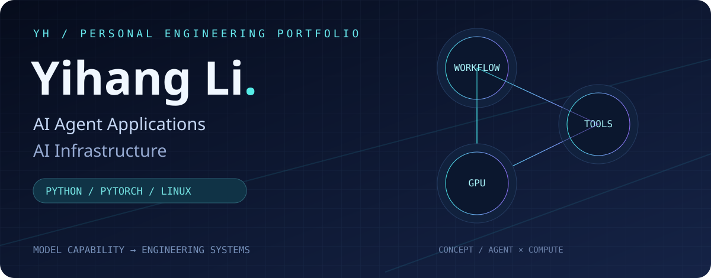
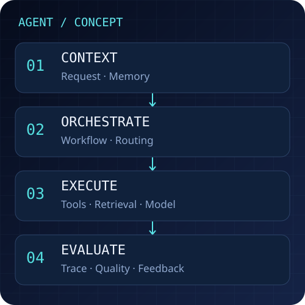
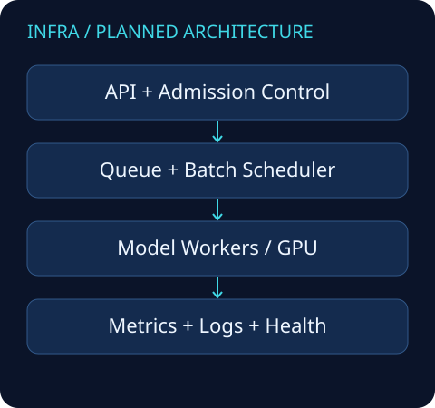

# 李亦航 / Yihang Li

**AI Agent 应用开发 · AI Infrastructure**

关注 AI Agent 应用开发与 AI Infra，致力于将大模型能力转化为可靠、可评估、可部署的工程系统。

我的当前技术背景是深度学习、Python、PyTorch、Linux、GPU 计算与模型实验评估。正在将研究中的模型开发思路延伸到应用系统工程；以下技术背景由本人提供，未来项目均明确标注为规划。

## 技术方向

### Agent Application Engineering

**学习与计划实践**：Agent Workflow、Tool Calling、RAG、Memory、Multi-Agent、Agent Evaluation、Observability。尚无经本次审查验证的已完成 Agent 项目。

### AI Infrastructure

**本人提供的技术背景**：模型开发、实验评估与 GPU Computing；尚无已验证的公开 Infra 项目。

**学习与计划实践**：LLM Serving、Concurrency、Batching、Caching、Monitoring、Reliability。科研训练中的 batch size 不等同于在线服务的动态 Batching。

## 技术栈与当前状态

| 状态 | 技术 | 说明 |
| :--- | :--- | :--- |
| 本人提供的技术背景 | Python、PyTorch、Linux、GPU 计算 | 不宣称熟练程度或生产部署经验 |
| 本次环境已验证 | Git / GitHub CLI | Windows 可找到 Git，CLI 已核实账号 |
| 待实践与验证 | Docker、FastAPI、Redis、PostgreSQL、LangGraph、vLLM | 不列为已掌握技能 |

## Featured Projects

**当前暂无经本次审查确认可公开、可复现且贡献归属明确的 Agent / Infra 已完成项目。** 以下是作品集开发路线，不是已完成成果。

### 01 · Agent Application Platform — 规划中

- 问题：让工具调用任务具备明确的执行边界与可追踪过程。
- 拟议架构：请求入口 → Workflow → Tool / RAG → 回答与执行记录。
- 计划功能：工具参数校验、超时与失败处理、检索引用、任务状态记录。
- 技术选型：Python；具体框架待原型验证后决定。
- 验收目标：提供安装说明、最小运行命令、固定测试任务、失败用例和脱敏 Demo。
- 当前状态：尚未实现；无运行命令、测试结果或 Demo。

### 02 · LLM Inference Service — 规划中

- 问题：将模型推理封装为可测量、可管理的服务。
- 拟议架构：API → 请求队列 → 模型 Worker → 指标与日志。
- 计划功能：并发控制、超时、健康检查、批处理与缓存策略实验。
- 技术选型：Python；模型运行时与服务框架待验证。
- 验收目标：明确硬件、模型版本、输入长度和负载，报告延迟分位数、吞吐和失败率。
- 当前状态：尚未实现；无运行命令、测试结果或 Demo。

### 03 · Agent Observability & Evaluation — 规划中

- 问题：定位 Agent 失败原因，并用固定数据集比较改动。
- 拟议架构：Trace 采集 → 脱敏存储 → 离线评估 → 回归报告。
- 计划功能：步骤追踪、工具错误分类、任务成功率、成本与耗时记录。
- 技术选型：Python；存储与可观测性组件待验证。
- 验收目标：提供固定样例、评分规则、失败案例与可复现评估命令。
- 当前状态：尚未实现；无运行命令、测试结果或 Demo。

## Engineering Practice

以下是后续交付采用的工程标准，尚不作为全部已完成的能力认证：

- 系统设计：说明组件职责、输入输出与失败边界。
- 自动化测试：覆盖正常流程、无效输入、超时与回归案例。
- 性能评估：公开评估条件、测量方法与结果限制。
- 可观测性：记录请求状态、耗时与错误，保护输入中的敏感信息。
- 文档与规范：提供运行步骤、依赖版本、项目归属和已知限制。

## Contact

GitHub：[yihangli-ai](https://github.com/yihangli-ai)

求职联系邮箱与个人网站待本人确认后补充。
